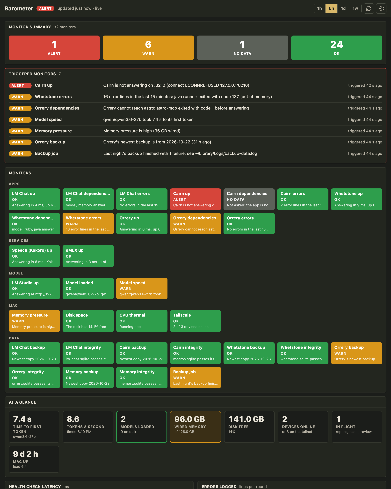
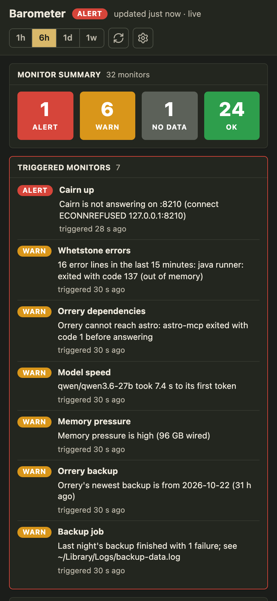
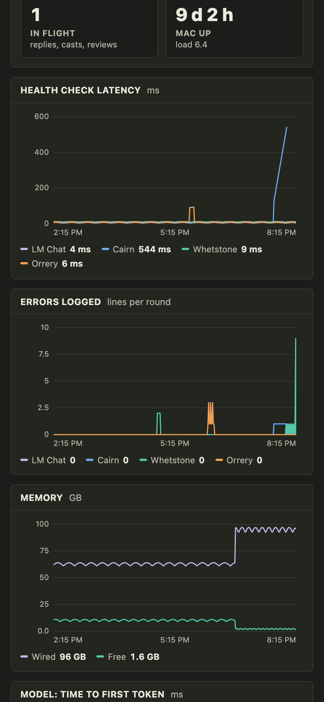

#  Barometer

A monitoring board for apps you run on your own Mac with local models and
reach from your phone over Tailscale. It watches each app and the services
beside it, the model server and how fast it answers, the machine itself,
and the databases and their backups. Every fifteen seconds it looks at all
of it, judges a monitor for each, keeps the numbers for the graphs, and
says so, on the Mac and on the phone, when a monitor leaves OK.

The screenshots come from its demo mode: a made-up bad afternoon with one
app down, another logging errors, a slow model and memory under pressure.

<table>
  <tr>
    <td width="50%"></td>
    <td width="50%"></td>
  </tr>
  <tr>
    <td><b>Monitors.</b> How many stand at alert, warn, no data and OK; the triggered ones with how long ago; then every monitor as a tile coloured by its status.</td>
    <td><b>Graphs.</b> Health-check latency and error lines per app, memory, the model's time to first token and tokens a second, load and disk, over the last hour, six hours, day or week. Hover or touch reads the values at one moment.</td>
  </tr>
</table>

Below the graphs: the numbers at a glance, a table of the apps (commit
deployed, uptime, what is in flight, dependencies, launchd start count,
errors in the last quarter hour), a table of the databases, the event stream
and the latest error lines from the apps' own logs.

## Your apps

What it watches is listed in `server/targets.ts`, since it is fixed by how
the Mac is set up rather than chosen on the page:

- **Apps**, each with its local port, its launchd label and log, and the
  port `tailscale serve` gives it on the tailnet. Each app answers
  `GET /api/health` in one shape; `server/health.ts` is a drop-in that
  produces it.
- **Services** beside them, such as a speech server or a second model
  server: anything that answers a URL.
- **Data**: each app's SQLite file, and where its dated backups land.

The model server is LM Studio, timed with a short completion now and then.

## The monitors

| Group | Monitor | Alert when |
| --- | --- | --- |
| Apps | *App* up | Its `GET /api/health` does not answer, two rounds running. |
| | *App* dependencies | The health route says a dependency (the model server, an MCP server, a data file) is down. |
| | *App* errors | Its launchd log gained more error lines in fifteen minutes than Settings allows. |
| Services | *Service* up | No answer, two rounds running. |
| Model | LM Studio up, Model loaded, Model speed | LM Studio does not answer; no model (or not the one Settings expects) is loaded; the timed completion is slower than the thresholds. |
| Mac | Memory pressure, Disk space, CPU thermal, Tailscale | macOS reports pressure; the disk is nearly full; the CPU is throttled; Tailscale is stopped or the Mac is offline on the tailnet. |
| Data | *Database* backup, *Database* integrity, Backup job | The newest dated copy in `~/Backups` is older than a day; SQLite's quick check fails; last night's backup job logged failures. |

Each app's `GET /api/health` has one shape: ok, the commit deployed, when it
started, what is in flight, whether its dependencies answer, and its data
file. A restart is told from a deploy by the commit: a new commit is a
deploy, the same commit is something to look at, with launchd's reason
pulled from the `services-watch` log.

Every monitor is judged every round (`server/monitors.ts`); one that is
warn or alert opens an alert, one back at OK closes it, and each change is
said once as a macOS notification and as a push to every phone that asked.

## Running it

Node 24 or newer. `npm install`, then:

- `npm run dev` on :8500, against a scratch database in `.data-dev`; it
  watches the same services but never times the model or notifies anyone.
- `npm run preview` on :8510 is the real instance, kept up by a launchd
  agent and served on the tailnet by `tailscale serve`.
- `npm run deploy` rebuilds and restarts that instance.
- `npm run seed:demo`, then `npm run dev:demo`, runs the demo on :8500:
  six hours of made-up history and probes that read nothing real
  (`server/demo.ts`).
- `BAROMETER_URL=http://127.0.0.1:8500 npm run screenshots` takes the
  pictures above from it.

Settings on the page hold the LM Studio URL and token, how often to time the
model, the thresholds, and whether to notify the Mac. Push to a phone needs
the app on the home screen; turn it on from Settings there.

## How it is built

React 19, TypeScript and Vite for the page; Node 24 with `node:sqlite` for
the server, which runs inside Vite as a plugin (`server/api.ts`). One
SQLite file holds raw samples for two days, five-minute rollups for ninety,
the events, the alerts, the settings and the push subscriptions. The page
keeps current over a server-sent stream and polls if that will not open.
The graphs are plain SVG. `npm run check` runs the typecheck, the lint and
the tests.
