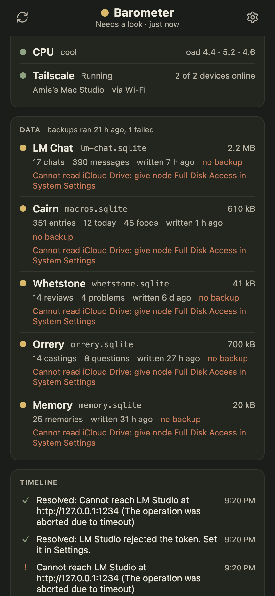

#  Barometer

What is running on the Mac, on one page: the four apps and the services
beside them, the model server and how fast it is answering, the machine
itself, and whether last night's backups happened. It watches every fifteen
seconds, keeps the numbers, and says so, on the Mac and on the phone, when
something needs a look.

<table>
  <tr>
    <td width="50%"></td>
    <td width="50%"></td>
  </tr>
  <tr>
    <td><b>The board.</b> Anything open at the top, then a row per app: its light, the commit deployed, how long its health route took, a sparkline of the last three hours, and what it depends on.</td>
    <td><b>Further down.</b> The Mac's memory, disk, heat and Tailscale; each database with its counts and newest backup; and the timeline of restarts, deploys and alerts.</td>
  </tr>
</table>

## What it watches

| Layer | What | How |
| --- | --- | --- |
| Apps | LM Chat, Cairn, Whetstone, Orrery | Each app's `GET /api/health` (one shape in all four: ok, the commit deployed, uptime, what is in flight, whether its dependencies answer, its data file), timed; and `launchctl print` for the pid and how many times launchd has started it. |
| Services | The speech server (Kokoro), oMLX | A request to each; oMLX also says what it has loaded. |
| Model | LM Studio | Which models are loaded and with what context. Every ten minutes, when nothing else is being written, a short timed completion: time to first token and tokens a second. |
| Mac | Memory pressure, wired and free memory, disk, load, thermal throttling, Tailscale, the default route | `sysctl`, `vm_stat`, `df`, `pmset -g therm`, `tailscale status --json`, `route`. |
| Data | Each app's SQLite file and the memory file | Size, last write, a few row counts, SQLite's quick check every fifteen minutes, and the newest dated copy in the iCloud Drive backup folder; plus the backup job's own log. |
| Events | Restarts, deploys, stops | An app whose start time moved has restarted: a deploy when its commit changed, otherwise something to look at, with launchd's reason from `services-watch`'s log. |

## Alerts

A rule opens an alert when it holds and closes it when it stops. Each is said
once, as a macOS notification and as a push to every phone that asked for one:

- an app or service not answering for two rounds running;
- an app that cannot reach the model server, astro-mcp or its memory file;
- LM Studio unreachable, or no model loaded (or not the one Settings expects);
- the timed completion slower than the thresholds in Settings;
- memory pressure high or critical, the disk nearly full, the CPU throttled;
- Tailscale stopped, or the Mac offline on the tailnet;
- a backup older than a day, or last night's backup job reporting failures;
- a database failing its quick check.

## Running it

Node 24 or newer. `npm install`, then:

- `npm run dev` on :8500, against a scratch database in `.data-dev`; it watches
  the same services but never times the model or notifies anyone.
- `npm run preview` on :8510 is the real instance, kept up by launchd
  (`com.amie.barometer`) and served on the tailnet by `tailscale serve`.
- `npm run deploy` rebuilds and restarts that instance.

Settings on the page hold the LM Studio URL and token, how often to time the
model, the thresholds, and whether to notify the Mac. Push to a phone needs
the app on the home screen; turn it on from Settings there.

The backup and iCloud checks read `~/Library/Mobile Documents`, which macOS
keeps from background processes until the `node` binary is given Full Disk
Access in System Settings; until then those rows say so and the rest of the
board works.

## How it is built

React 19, TypeScript and Vite for the page; Node 24 with `node:sqlite` for the
server, which runs inside Vite as a plugin (`server/api.ts`). One SQLite file
holds raw samples for two days, five-minute rollups for ninety, the events,
the alerts, the settings and the push subscriptions. The page keeps current
over a server-sent stream and polls if that will not open. `npm run check`
runs the typecheck, the lint and the tests.
